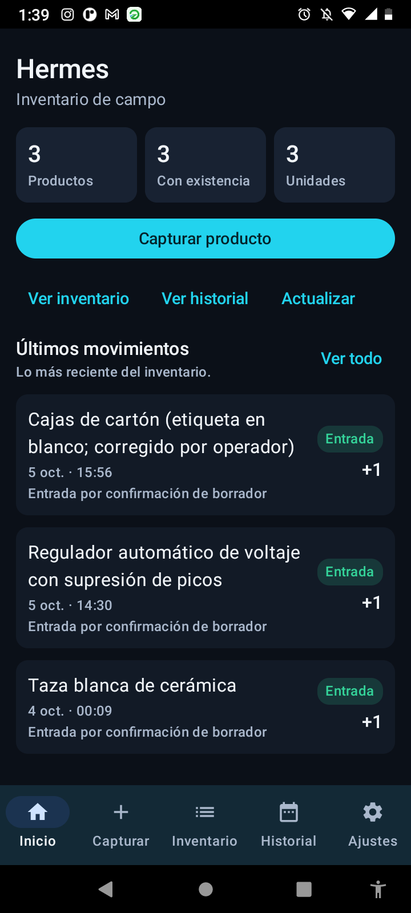
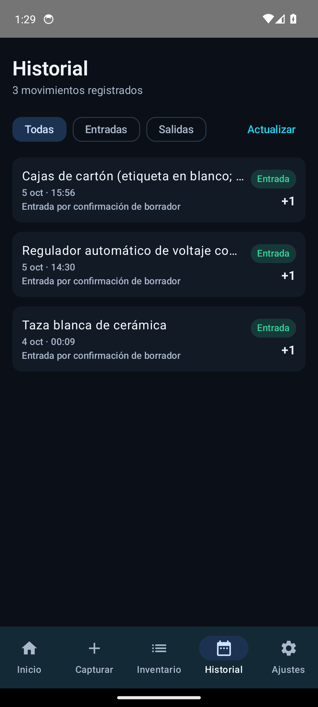
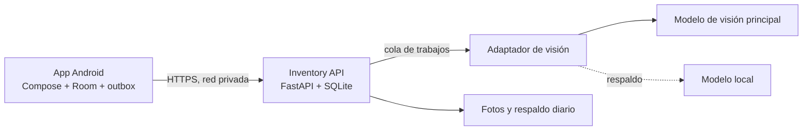

# Hermes Inventory

Un almacén pequeño de accesorios y equipos, llevado en la cabeza de una persona y en una hoja de cálculo. La idea era simple: que bastara una foto.

Le tomas una foto a la etiqueta, el modelo de visión propone el producto con su modelo, su serie y su cantidad, y tú confirmas o corriges. Lo que entra al inventario es lo que confirmaste, nunca lo que adivinó la máquina.

## Por qué no es tan simple como suena

Porque una foto miente. La etiqueta está borrosa, la caja trae un pack de diez, el teléfono tiene dos IMEI, la serie ya existe, el modelo alucina una cantidad que nadie pidió. Y porque el almacén no tiene buena señal, así que capturar y confirmar tienen que funcionar sin internet y reconciliarse después sin duplicar nada.

La regla que sostiene todo el diseño: **el sistema nunca inventa un resultado**. Si la visión falla o el modelo devuelve basura, el trabajo queda como fallido y accionable, con las fotos guardadas y la razón escrita. Un inventario que miente es peor que una hoja de cálculo.

## Qué quedó funcionando

La app Android captura, revisa y confirma; el backend guarda productos, fotos, saldos y movimientos, y encola los análisis. El stock se mueve con estados (`AVAILABLE`, `ASSIGNED`, `DAMAGED`, `RMA`) y cada operación lleva una llave de idempotencia, así que reintentar por mala red no duplica entradas.

Los 18 casos de aceptación se cerraron con evidencia y con la procedencia declarada fila por fila: lo verificado de forma independiente, lo heredado de una corrida anterior y lo probado en el espejo. Tres pasadas de auditoría, dos de ellas pidiendo correcciones, hasta llegar a veredicto limpio. Entre los casos que más trabajo dieron:

- Serie o IMEI duplicado: rechazo `409` y ninguna fila nueva.
- Salida de 999 piezas sin saldo: `409 INSUFFICIENT_STOCK` y cero movimientos escritos.
- Foto capturada sin conexión, app cerrada a la fuerza y reabierta: el trabajo sobrevive en la cola y termina solo.
- Backend asesinado a media ejecución: el trabajo huérfano regresa a la cola, se reintenta y termina bien.
- Imagen con instrucciones maliciosas escritas encima: la orden no entra a los datos y el sistema avisa.

Y una cadena completa de estados probada de punta a punta: diez unidades que pasan a asignadas, dañadas, en RMA y de vuelta a disponibles, terminando donde empezaron.

## Arquitectura

## Decisiones que valen la pena

**La base de existencias es del inventario, no del agente.** El agente extrae datos y contesta consultas; no es la fuente de verdad del stock. Esa separación es la que permite caer el modelo sin perder el inventario.

**IDs creados en el cliente.** Los identificadores nacen en el teléfono, así que una captura hecha sin red tiene referencia estable desde el primer segundo y se reconcilia después sin adivinar a qué fila pertenece.

**"Pendiente" no es "existencia".** La app distingue explícitamente lo capturado de lo confirmado en servidor. Confundir los dos es cómo un inventario empieza a mentir sin que nadie lo note.

**Respaldo con restauración probada.** Ocho tablas, relaciones, saldos y fotos regresan idénticos, con `integrity_check: ok`. Respaldo que nunca se restauró es una carpeta con archivos, no un respaldo.

## Estado

Es un sistema de prueba, desarrollado y validado en laboratorio. No está desplegado de forma oficial en ningún lado, y así se documenta. Funciona de punta a punta en el teléfono y en el servidor de pruebas; las fases siguientes están en curso.

## Stack

Android con Kotlin, Compose, Room, WorkManager y CameraX; lectura local de códigos con ML Kit. Backend en Python 3.12 con FastAPI, Uvicorn y SQLite. Visión con un modelo en la nube y respaldo en un modelo local.

## Sobre el código

Repositorio de exhibición: arquitectura, criterios de aceptación y resultados medidos. No incluye APK, código de la app ni del backend, ni ningún dato real de inventario, número de serie o fotografía de etiquetas.

© 2026 Javier Cuevas. Todos los derechos reservados.
